<div align="center">

[한국어](README.md) | **日本語**

# 🤖 スーパーロボット大戦EX 韓国語パッチ

スーパーファミコン **「スーパーロボット大戦EX」**（1994）のセリフ、メニュー、ステージタイトル、タイトルロゴまで韓国語に翻訳した非公式ファンパッチ

[](https://github.com/game-patch-ko/srwex-ko/releases)
[](#-パッチの当て方)
[](#-パッチの当て方)
[](#-仕組み)
[](#-フォントとライセンス)

[**ダウンロード**](https://github.com/game-patch-ko/srwex-ko/releases) · [パッチの当て方](#-パッチの当て方) · [不具合の報告](#-不具合の報告) · [仕組み](#-仕組み) · [自分でビルドする](#-自分でビルドする) · [権利について](#-権利について)

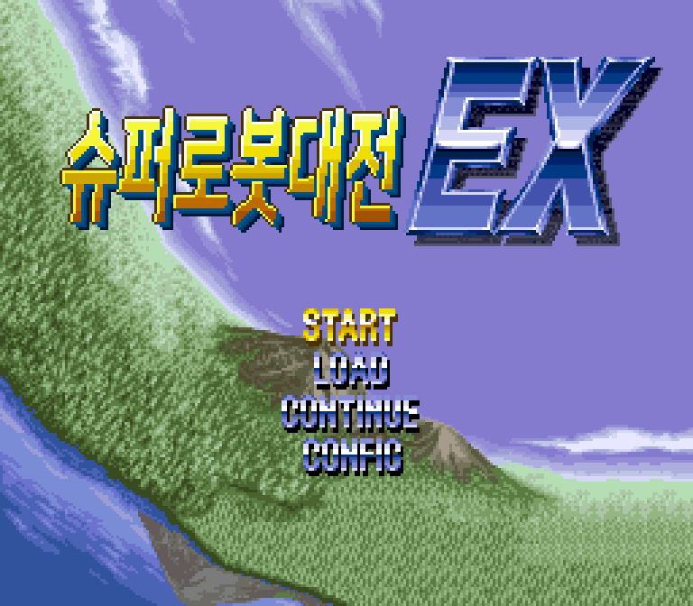

</div>

## ✨ 特徴

| | |
|---|---|
| 📝 **ゲーム全体を翻訳** | マサキの章・リューネの章・シュウの章のセリフと戦闘セリフ、パイロット・ユニット・武器名、地形、メニューやウィンドウの文言まで、6,494個の断片を翻訳しました。 |
| 🔤 **ハングル2,048枠** | ROMを2MBに拡張し、12pxのドットフォントMonaS12でハングルを収録しました。翻訳で実際に使う音節（現在1,094字）をビルドのたびに選んで収めます。 |
| 🎬 **グラフィック文字も** | ステージ導入タイトル64個（「제1화 『랑그란 동란』」＝「第1話『ラングラン動乱』」）とタイトルロゴ「슈퍼로봇대전」をハングルで描き直しました。 |
| 🗣️ **キャラクターごとの口調** | ロドニーなどの関西弁は慶尚道方言にしました。表記は[第3次スーパーロボット大戦 韓国語パッチ](https://github.com/game-patch-ko/srw3-ko)に合わせています。 |
| 📐 **画面幅に合わせた改行** | ゲームの行幅の上限（会話240px、戦闘200px）を実測し、すべてのセリフをその範囲に収めました。 |
| 🩹 **元のROMはそのまま** | 配布するのはxdelta・IPSパッチだけです。元のROMではなくコピーに当てます。 |

## 🖼️ スクリーンショット

### 原文との比較

<table>
  <tr>
    <th>原文</th>
    <th>韓国語パッチ</th>
  </tr>
  <tr>
    <td>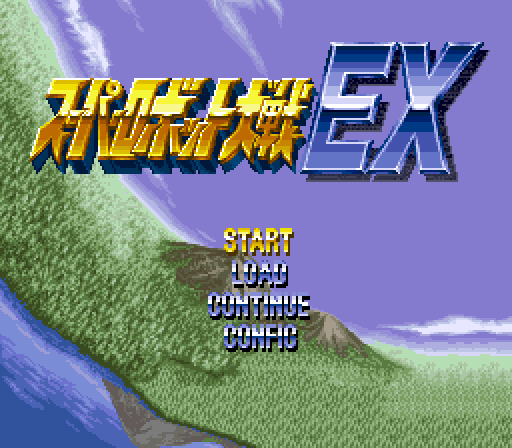</td>
    <td></td>
  </tr>
  <tr>
    <td>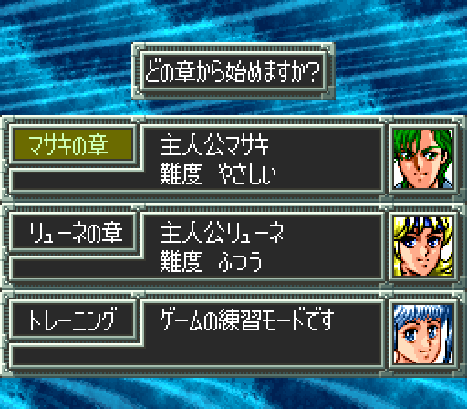</td>
    <td>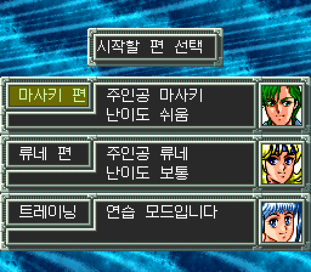</td>
  </tr>
  <tr>
    <td>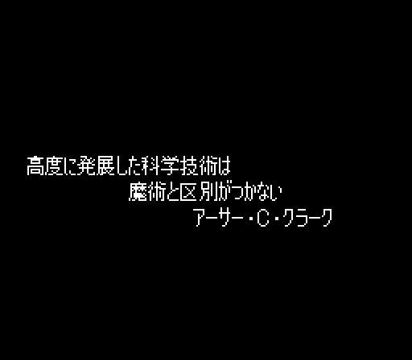</td>
    <td>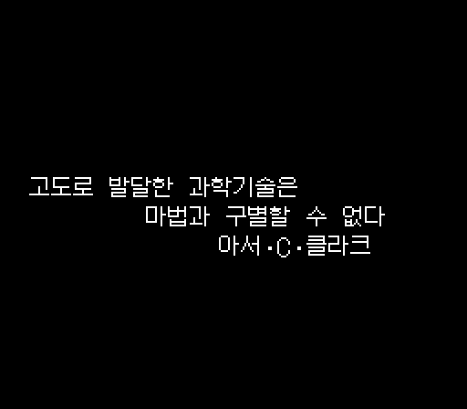</td>
  </tr>
  <tr>
    <td>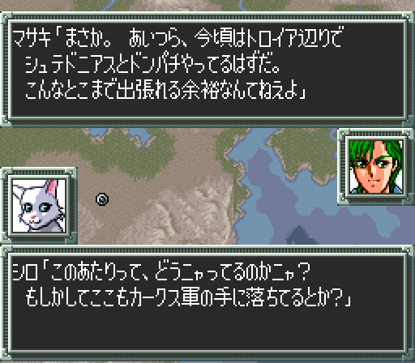</td>
    <td>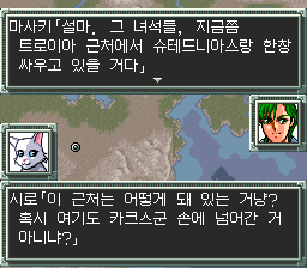</td>
  </tr>
  <tr>
    <td>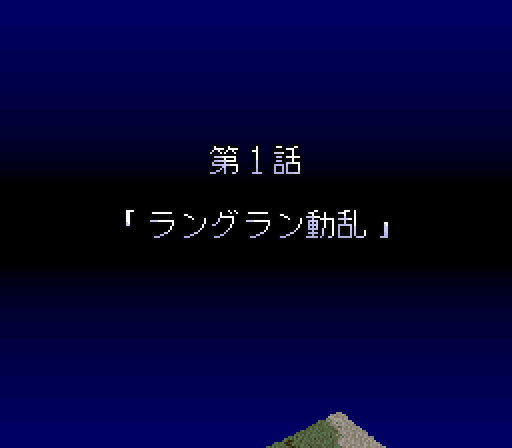</td>
    <td>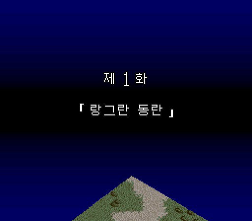</td>
  </tr>
  <tr>
    <td>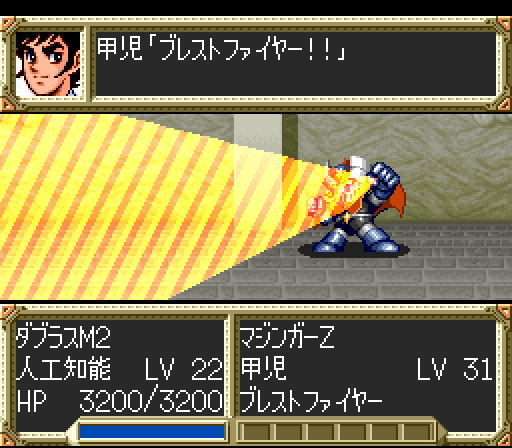</td>
    <td>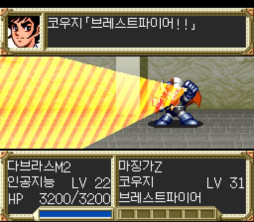</td>
  </tr>
</table>

### マップとメニュー

<table>
  <tr>
    <td>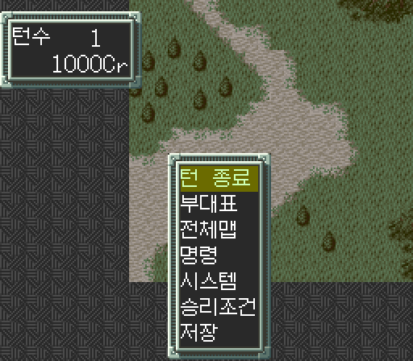</td>
    <td>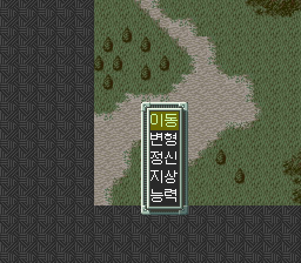</td>
  </tr>
  <tr>
    <td align="center">ターンメニューとターン表示</td>
    <td align="center">ユニットコマンド</td>
  </tr>
  <tr>
    <td>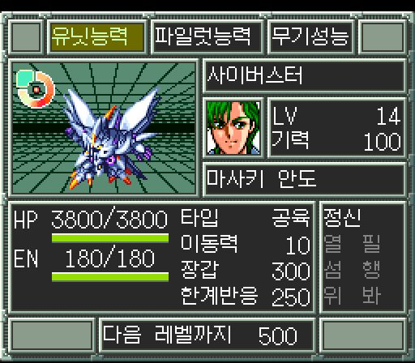</td>
    <td>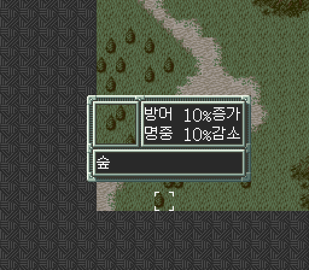</td>
  </tr>
  <tr>
    <td align="center">ユニット能力</td>
    <td align="center">地形情報</td>
  </tr>
</table>

## 🚀 パッチの当て方

### 1. 元のROMを確認する

ご自身でお持ちの元のROMが必要です。このリポジトリとリリースにROMは含まれていません。

| 項目 | 値 |
|---|---|
| ファイル | `Super Robot Taisen EX (J).smc`（名前は違っていても構いません） |
| サイズ | 1,572,864バイト（ヘッダなし） |
| CRC32 | `239621A0` |
| SHA-1 | `29e78bcb3bcc7f353804ac002ce651e121bd8aa0` |

> [!WARNING]
> サイズが **1,573,376バイト** の場合、先頭に512バイトのコピー機ヘッダが付いています。ヘッダを削除してからパッチを当ててください。
> xdeltaはヘッダ付きROMをエラーで拒否しますが、**IPSはエラーを出さずに「成功」と表示し、壊れたROMを作ってしまいます。**

### 2. xdeltaでパッチを当てる（推奨）

[リリース](https://github.com/game-patch-ko/srwex-ko/releases)から `srwex_ko.xdelta` をダウンロードします。元のROMをコピーし、コピーの方に当ててください。

| 方法 | 使い方 |
|---|---|
| 🌐 **ウェブ** | [Rom Patcher JS](https://www.marcrobledo.com/RomPatcher.js/) でROMと `srwex_ko.xdelta` を選び、**Apply patch** |
| 🖱️ **Windowsアプリ** | Delta Patcherで元のROMと `srwex_ko.xdelta` を選び、**Apply patch** |
| ⌨️ **コマンドライン** | 下記のコマンド（[xdelta3](https://github.com/jmacd/xdelta-gpl/releases)） |

```bash
xdelta3 -d -s "Super Robot Taisen EX (J).smc" srwex_ko.xdelta srwex_ko.smc
```

### 3. 結果を確認する

| 項目 | 値 |
|---|---|
| サイズ | 2,097,152バイト（2MB） |
| CRC32 | `FEBC62A7` |
| SHA-1 | `f660331b19b26d65d831ea907411c5efaa698634` |

できあがった `srwex_ko.smc` をエミュレータでそのまま開きます。

> [!TIP]
> **IPSのソフトパッチ:** Mesenやsnes9xなどは、ROMと同じフォルダに同じ名前の `.ips` があると起動時に自動で適用します（例: `srwex.smc` + `srwex.ips`）。この方法にも対応していますが、ヘッダの問題を防げるxdeltaをおすすめします。

> [!IMPORTANT]
> セーブデータやステートセーブを元のROMと混ぜて使わないでください。ROMのサイズとテキストの位置が違うため、元のROMのステートセーブを読み込むと画面が崩れることがあります。

## 🐞 不具合の報告

誤訳、不自然な文、文字化け、ウィンドウからのはみ出し、フリーズなどを見つけたら、[**Issueで教えてください**](https://github.com/game-patch-ko/srwex-ko/issues/new/choose)。GitHubアカウントがあればどなたでも登録でき、フォームに沿って書くだけです。日本語で書いていただいて構いません。

| 一緒に教えていただけると助かるもの | 理由 |
|---|---|
| 📸 **スクリーンショット** | 画面の文から翻訳スクリプトの該当箇所をすぐに探せます |
| 📍 **場面**（どの章の何話のどの画面か） | 同じ文が複数の場所にある場合に区別できます |
| 💾 **ステートセーブ**（.mssなど、zipで添付） | その場面をそのまま再現し、修正結果を確認できます |
| 🎮 **エミュレータとパッチの当て方** | 特定のエミュレータだけで起きる問題を切り分けます |

> [!TIP]
> ベータ版です。特に **インターミッション**（改造・乗り換え・廃棄）、**エンディング**、**サウンドテストの曲名**、**第2話以降のステージタイトル** は、まだ実際の画面で確認できていません。この部分のスクリーンショットは、問題がなくても大いに役立ちます。

## 🏆 やったこと

### 翻訳範囲

| 区分 | 内容 | 規模 |
|---|---|---|
| 💬 **セリフ** | マサキの章・リューネの章・シュウの章の会話、作戦画面、戦闘セリフ | セリフブロック33個 |
| 🏷️ **名前・用語** | パイロットのフルネーム・略称、ユニット、武器、地形、曲名、属性・設定 | 832項目 |
| 🪟 **ウィンドウの文言** | システムメニュー、能力画面、章選択、プロローグ、トレーニングの説明 | レイアウト3個 |
| 🎬 **グラフィック文字** | ステージ導入タイトル、タイトルロゴ | タイトル64個、ロゴ1個 |

タイトル画面の `START` `LOAD` `CONTINUE` `CONFIG` とロゴの「EX」は英語のまま残しました。

### 表記の方針

- 第3次の韓国語パッチと同じ表記に従います。ゲッターは **게타** に統一しました。
- 武器・技の名前は、武器表でもセリフでも分かち書きしません（例: `아카식버스터`、`사이플래시`）。
- 固有名詞: ソラティス **솔라티스**、グラン・ガラン **그란가란**、かくれみの **은신 망토**、隠行の術 **은형의 술**。

### 作業の流れ

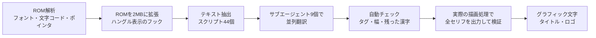

## 🔍 仕組み

元のゲームは1バイトのかなと2バイトの漢字（先頭バイト `F0~F3`）を使います。パッチは先頭バイト `EC~F3` の8個をハングル専用にし、その下の2,048枠に翻訳で使う音節を収めます。

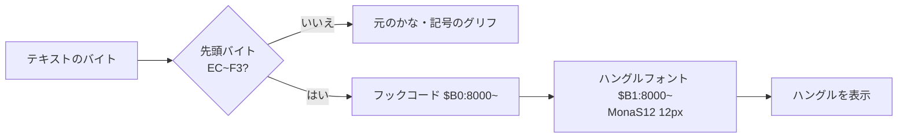

| 対象 | 変更内容 |
|---|---|
| ROMサイズ | 1.5MB → 2MB（LoROM拡張、バンク `$B0~$BF`） |
| 文字の解釈 | セリフ `$81:85E6`、ウィンドウテキスト `$80:B9BD` の先頭バイト判定と、グリフアドレス計算 `$80:BADF`・`$80:BC75` をフック |
| ハングルフォント | 翻訳で使う音節だけをKS X 1001の順に割り当て、ドットフォントMonaS12（12px）を変換、`$B1:8000~` |
| テキスト配置 | 翻訳文をバンク `$B3~$BE` に再配置し、セリフブロック表 `$0C:8000`、名前・ウィンドウ表の一覧 `$03:8090` を修正 |
| ステージタイトル | 16×16のタイトルフォント（LZ圧縮）をMonaS12の字形に縁取り・グラデーションを付けて作り直し、タイトルのスプライト64個を書き直し |
| タイトルロゴ | ロゴのタイルに「슈퍼로봇대전」を描き直し（ナヌムスクエア ExtraBold）、青い「EX」はそのまま |

<details>
<summary><b>解析の詳細</b></summary>

- 第3次と同じ系統のエンジンですが、コードの配置と制御コードの番号が違うため（バンクごとのバイト一致率1~11%）、アドレスはすべて新たに調べました。セリフの制御コードは第3次より1つずつずれています（`F4` 改行 … `FF` 終端）。
- 元の先頭バイト `EC~EF` にあったアイコン文字（[M][HP][B][P]）はテキストで使われていないため、空いている1バイトコードに移しました。
- `.` `,` は和文の `。`（E4）・`、`（3A）の位置に韓国語用の形を描き直して使います。
- 行幅の上限は `$0E34`（4px単位）です。会話ウィンドウは60単位（240px）、戦闘ウィンドウは50単位（200px）・2行で、ビルド時にこの値ですべてのセリフの幅をチェックします。
- ステージタイトルはグラフィック資料4番（`$20:91A6`、LZ圧縮32KB）のフォントとスプライト表（`$04:CEFE`）で描かれます。ステージごとのフォントブロックは、候補をすべて描画して目で照合して決めました。
- タイトルロゴはグラフィック資料47番（`$13:8000`）のタイル0x201~0x275で、タイルマップはそのままにタイルの絵だけを差し替えます。

</details>

## ✅ 検証

| 検査 | 方法 | 結果 |
|---|---|---|
| 全セリフの出力 | Mesen2のLuaでセリフの断片を順に実際の描画処理へ流して出力 | セリフ33ファイルを最後まで出力、停止0件 |
| 行のはみ出し | 同じ出力で行幅の上限を記録 | 1か所（顔の切り替えが続く場面）— 原文の日本語も同じ装置で同じ位置がはみ出すため、テスト装置の限界と判断 |
| 実際の画面 | 新規ゲーム → 章選択 → プロローグ → 第1話の会話・タイトル・マップ、ユニットコマンド・能力画面、デモ戦闘 | 正常 |
| パッチの適用 | xdelta3 3.1.0・Flipsで元のROMのコピーに適用 | ビルドしたROMとMD5が一致 |

> [!NOTE]
> 確認したエミュレータはMesen2 2.1.1のみです。人が最初から最後までプレイして確認してはおらず、インターミッション・エンディング・サウンドテストは実際の進行で確認できていません。一部のウィンドウで長い名前が枠に触れることがあります。

## 🤖 作業方法: 人が指揮したAIハーネス

このパッチは、**人が方針と表記を決め、AIハーネス [Claude Code](https://claude.com/claude-code) 上でClaudeが解析・実装・翻訳・検証を担当して**作りました。

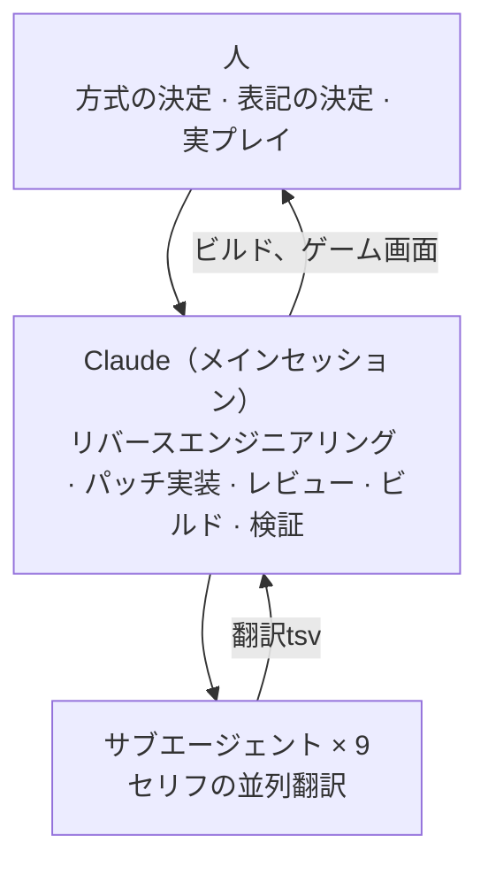

| 役割 | 担当 | やったこと |
|---|---|---|
| 🧑 **作業の指揮** | 人 | 第3次パッチの方式・表記基準を適用する決定、実プレイとフィードバック |
| 🧠 **統括** | Claude | 65816のリバースエンジニアリング、フック・フォント・グラフィックのパッチ、抽出・挿入ツール、名前・ウィンドウの翻訳、翻訳レビュー、自動検証 |
| ✍️ **翻訳** | Claudeのサブエージェント | 翻訳指針に従い、セリフをファイルごとに分けて並列翻訳 |

AIの翻訳をそのまま使ってはいません。タグの順序、行幅、残ったかな・漢字をツールでチェックし、実際のゲームの描画処理で全セリフを出力して確認しました。

## 🛠️ 自分でビルドする

<details>
<summary><b>ビルド方法を開く</b></summary>

| 必要なもの | 内容 |
|---|---|
| Python 3 | `Pillow` |
| 元のROM | リポジトリのルートに `Super Robot Taisen EX (J).smc` |
| セリフ・メニュー・タイトルのフォント | [MonaS12](https://github.com/MonadABXY/mona-font) リリース `2026.10.09` の `MonaFont-ttf.zip` を `tools/fonts/mona/` に展開（`MonaS/01 Main/MonaS12.ttf`）。別の場所なら環境変数 `SRW3_MONAS12` でファイルを指定 |
| ロゴのフォント | ナヌムスクエア ExtraBold（`NanumSquareEB.ttf`）。既定ではWindowsのユーザーフォントフォルダから探し、別の場所なら環境変数 `SRW3_FONTDIR` でフォルダを指定 |

```bash
cd build
python srwtext.py build
```

結果は `out/srwex_ko.smc` と `out/srwex_ko.ips` にできます。配布用のxdeltaは次のように作ります。

```bash
xdelta3 -e -9 -s "Super Robot Taisen EX (J).smc" out/srwex_ko.smc srwex_ko.xdelta
```

- 翻訳は `script/*.txt` の `KO:` 行を直すか、`tr/` のtsvを `python setko.py --file ../tr/x.tsv` で反映します。
- 作業の引き継ぎ文書は [HANDOFF.md](HANDOFF.md)（韓国語）、解析文書は `analysis/` にあります。

</details>

## 📁 リポジトリの構成

```text
├── analysis/    ROM解析の文書とツール
├── build/       パッチのビルド（抽出・挿入、フック・フォント、ステージタイトル、タイトルロゴ）
├── script/      翻訳スクリプト44個（セリフ dlg*、名前 sys*、ウィンドウレイアウト lay*）— 原文（JP:）と翻訳（KO:）の対照
├── tr/          翻訳補助ツールと翻訳元のtsv
├── tools/rt/    Mesen2の自動検証Luaとスクリプト生成ツール
├── dist/        配布パッケージのREADME.txtとOFL.txt
├── docs/images/ READMEのスクリーンショット
└── HANDOFF.md   作業の引き継ぎ文書
```

`script/` と `tr/` には、翻訳の対照と校閲のために日本語の原文も含まれています。元のROM、ビルドしたROM、エミュレータはリポジトリに入れていません。パッチファイルはReleaseの添付で配布します。

## 🔤 フォントとライセンス

| 使用箇所 | フォント | 制作 |
|---|---|---|
| セリフ・メニュー・名前（12px）、ステージ導入タイトル | [MonaS12](https://github.com/MonadABXY/mona-font) | Monad ABXY |
| タイトルロゴ | ナヌムスクエア ExtraBold | NAVER |

いずれもSIL Open Font License 1.1で配布されているフォントを白黒ビットマップに変換して収録しています。著作権表示とライセンス全文はリリースの `OFL.txt` にあります。

## ⚖️ 権利について

- **目的:** スーパーロボット大戦EXが好きな韓国のファンのために、純粋にファンの立場で作りました。営利目的はなく、無料で提供します。
- **権利:** 原作および登場作品・キャラクターのすべての権利は各権利者に帰属します。このパッチは非公式であり、権利者の承認を受けていません。制作者はこのパッチについていかなる排他的権利も主張しません。
- **ROMは含みません:** 配布するのはパッチファイルだけで、ROMは配布しません。パッチを当てるには、ご自身でお持ちの元のROMが必要です。
- **提供の中止:** 権利者から要請があった場合、パッチの提供を中止することがあります。
- **対応について:** 制作者は会社勤めの一般人です。不具合の報告への対応が遅れることがありますので、ご了承ください。

## 📢 AI利用の告知

このプロジェクトは、AnthropicのAIモデルであるClaudeと一緒に制作しました。責任は作成者にあります。
