<div align="center">

**한국어** | [日本語](README.ja.md)

# 🤖 슈퍼로봇대전 EX 한국어 패치

슈퍼 패미컴 **「スーパーロボット大戦EX」**(1994)의 대사, 메뉴, 스테이지 제목, 타이틀 로고까지 한국어로 옮긴 비공식 팬 패치

[](https://github.com/game-patch-ko/srwex-ko/releases)
[](#-패치-방법)
[](#-패치-방법)
[](#-어떻게-동작하나요)
[](#-글꼴과-라이선스)

[**다운로드**](https://github.com/game-patch-ko/srwex-ko/releases) · [패치 방법](#-패치-방법) · [문제 제보](#-문제-제보) · [동작 원리](#-어떻게-동작하나요) · [직접 빌드](#-직접-빌드) · [권리와 안내](#-권리와-안내)

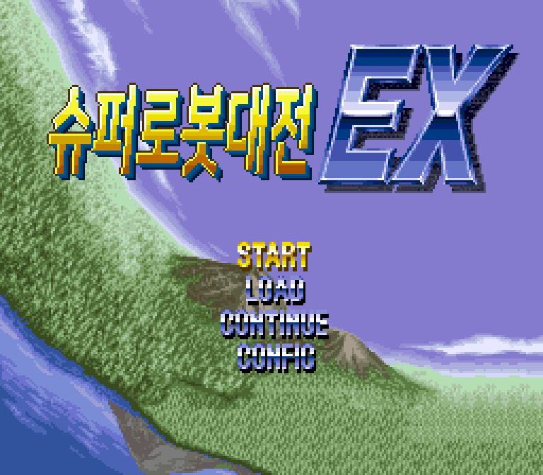

</div>

## ✨ 특징

| | |
|---|---|
| 📝 **게임 전체 번역** | 마사키 편·류네 편·슈우 편의 대사와 전투 대사, 파일럿·유닛·무기 이름, 지형, 메뉴와 창 문구까지 6,494개 조각을 번역했습니다. |
| 🔤 **한글 2,048칸** | ROM을 2MB로 늘리고 12px 도트 글꼴 MonaS12로 한글을 넣었습니다. 번역에 실제로 쓰인 음절(현재 1,094자)을 빌드할 때마다 골라 담습니다. |
| 🎬 **그래픽 글자까지** | 스테이지 도입 제목 64개(「제1화 『랑그란 동란』」)와 타이틀 로고 「슈퍼로봇대전」을 한글로 다시 그렸습니다. |
| 🗣️ **인물별 말투** | 로드니 등의 간사이 사투리는 경상도 말씨로 옮겼습니다. 표기는 [제3차 슈퍼로봇대전 한국어 패치](https://github.com/game-patch-ko/srw3-ko)와 맞췄습니다. |
| 📐 **화면 폭에 맞춘 줄바꿈** | 게임의 줄 폭 한도(대화 240px, 전투 200px)를 실측해 모든 대사를 그 안에 맞췄습니다. |
| 🩹 **원본은 그대로** | xdelta·IPS 패치만 배포합니다. 원본 ROM을 직접 고치지 않고 복사본에 적용합니다. |

## 🖼️ 스크린샷

### 원문과 비교

<table>
  <tr>
    <th>원문</th>
    <th>한국어 패치</th>
  </tr>
  <tr>
    <td>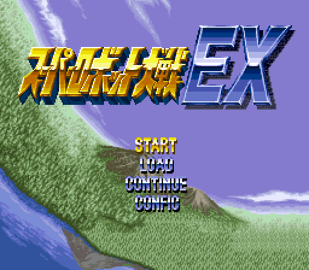</td>
    <td></td>
  </tr>
  <tr>
    <td>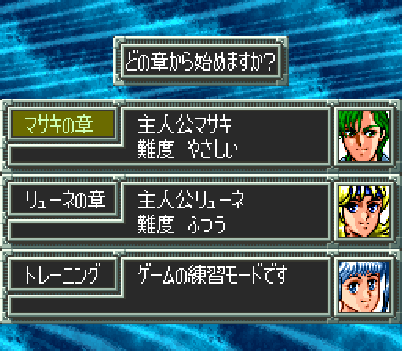</td>
    <td>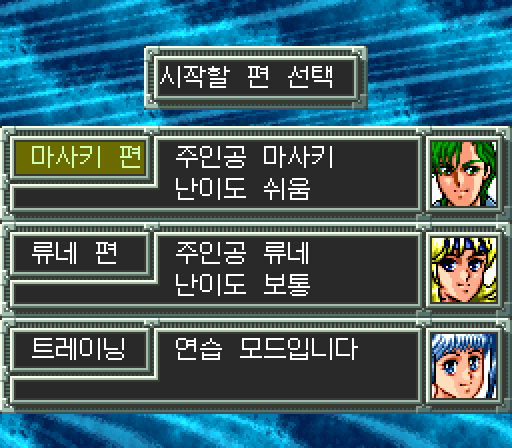</td>
  </tr>
  <tr>
    <td>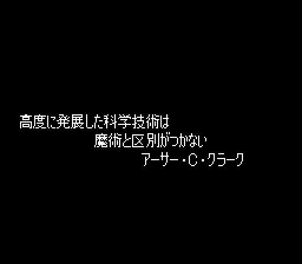</td>
    <td>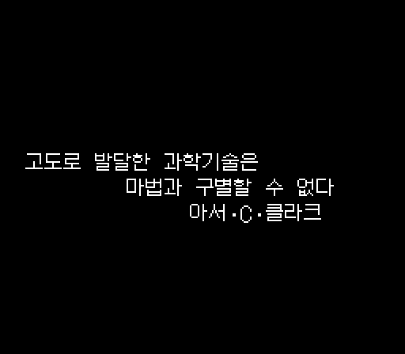</td>
  </tr>
  <tr>
    <td>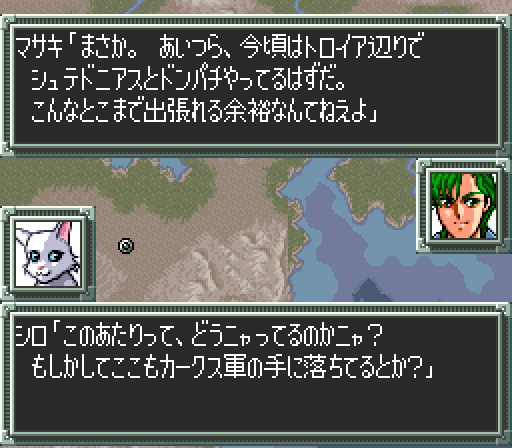</td>
    <td>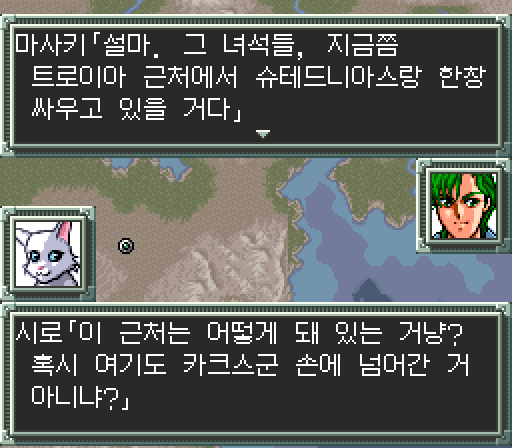</td>
  </tr>
  <tr>
    <td>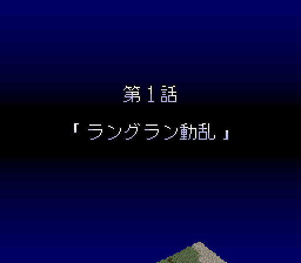</td>
    <td>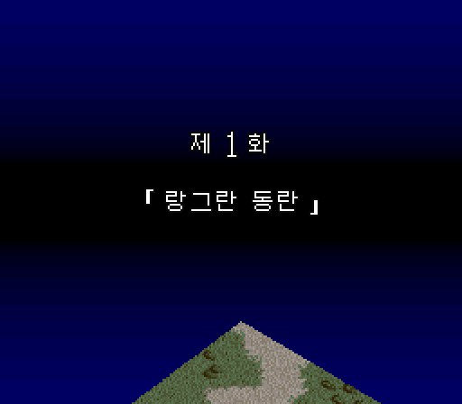</td>
  </tr>
  <tr>
    <td>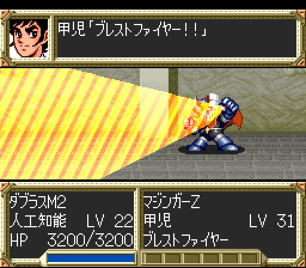</td>
    <td>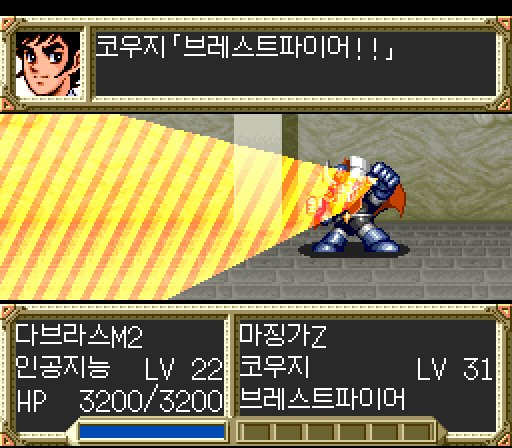</td>
  </tr>
</table>

### 지도와 메뉴

<table>
  <tr>
    <td>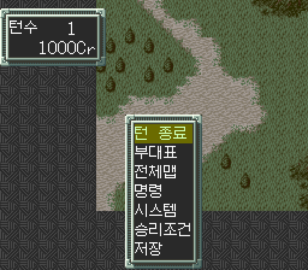</td>
    <td>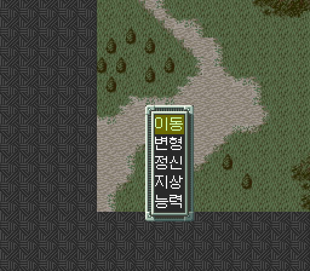</td>
  </tr>
  <tr>
    <td align="center">턴 메뉴와 턴 창</td>
    <td align="center">유닛 명령 메뉴</td>
  </tr>
  <tr>
    <td>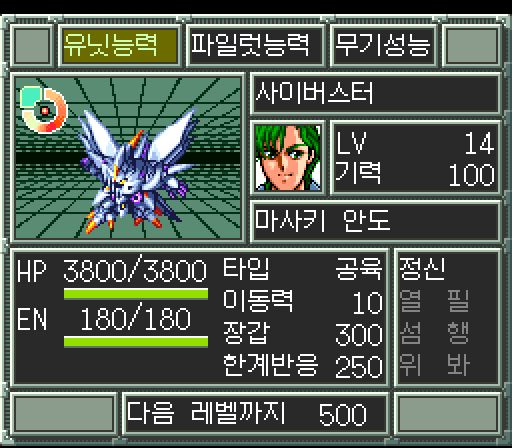</td>
    <td>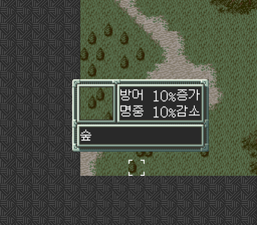</td>
  </tr>
  <tr>
    <td align="center">유닛 능력</td>
    <td align="center">지형 정보</td>
  </tr>
</table>

## 🚀 패치 방법

### 1. 원본 ROM 확인

직접 가지고 있는 원본 ROM이 필요합니다. 이 저장소와 릴리스에는 ROM이 없습니다.

| 항목 | 값 |
|---|---|
| 파일 | `Super Robot Taisen EX (J).smc` (이름은 달라도 됩니다) |
| 크기 | 1,572,864바이트 (헤더 없음) |
| CRC32 | `239621A0` |
| SHA-1 | `29e78bcb3bcc7f353804ac002ce651e121bd8aa0` |

> [!WARNING]
> 크기가 **1,573,376바이트**이면 앞에 512바이트 복사기 헤더가 붙은 ROM입니다. 헤더를 지운 뒤 패치하세요.
> xdelta는 헤더 붙은 ROM을 오류로 거부하지만, **IPS는 오류 없이 "성공"이라고 하면서 망가진 ROM을 만듭니다.**

### 2. xdelta로 패치 (권장)

[릴리스](https://github.com/game-patch-ko/srwex-ko/releases)에서 `srwex_ko.xdelta`를 받습니다. 원본 ROM을 복사해 두고 복사본에 적용하세요.

| 방법 | 사용법 |
|---|---|
| 🌐 **웹** | [Rom Patcher JS](https://www.marcrobledo.com/RomPatcher.js/)에서 ROM과 `srwex_ko.xdelta`를 고르고 **Apply patch** |
| 🖱️ **Windows 프로그램** | Delta Patcher에서 원본 ROM과 `srwex_ko.xdelta`를 고르고 **Apply patch** |
| ⌨️ **명령줄** | 아래 명령 ([xdelta3](https://github.com/jmacd/xdelta-gpl/releases)) |

```bash
xdelta3 -d -s "Super Robot Taisen EX (J).smc" srwex_ko.xdelta srwex_ko.smc
```

### 3. 결과 확인

| 항목 | 값 |
|---|---|
| 크기 | 2,097,152바이트 (2MB) |
| CRC32 | `FEBC62A7` |
| SHA-1 | `f660331b19b26d65d831ea907411c5efaa698634` |

만든 `srwex_ko.smc`를 에뮬레이터에서 바로 엽니다.

> [!TIP]
> **IPS 소프트 패치:** Mesen, snes9x 등은 ROM과 같은 폴더에 같은 이름의 `.ips`가 있으면 실행할 때 자동으로 적용합니다(예: `srwex.smc` + `srwex.ips`). 이 방법도 지원하지만, 헤더 문제를 막아 주는 xdelta를 먼저 권합니다.

> [!IMPORTANT]
> 세이브와 상태 저장은 원본 ROM과 섞어 쓰지 마세요. ROM 크기와 텍스트 위치가 달라서 원본의 상태 저장을 불러오면 화면이 깨질 수 있습니다.

## 🐞 문제 제보

오역, 어색한 문장, 글자 깨짐, 창 넘침, 멈춤을 발견하면 [**이슈로 알려 주세요**](https://github.com/game-patch-ko/srwex-ko/issues/new/choose). GitHub 계정이 있으면 누구나 등록할 수 있고, 양식에 맞춰 적으면 됩니다.

| 함께 알려 주시면 좋은 것 | 이유 |
|---|---|
| 📸 **스크린샷** | 화면의 문구로 번역 스크립트에서 해당 조각을 바로 찾습니다 |
| 📍 **장면 위치** (어느 편, 몇 화, 어떤 화면) | 같은 문구가 여러 곳에 있을 때 구분합니다 |
| 💾 **상태 저장 파일** (.mss 등, zip으로 첨부) | 그 장면을 그대로 다시 띄워 고친 결과를 확인합니다 |
| 🎮 **에뮬레이터와 패치 방법** | 특정 에뮬레이터에서만 생기는 문제를 가려냅니다 |

> [!TIP]
> 베타 버전입니다. 특히 **인터미션**(개조·교체·폐기), **엔딩**, **사운드 테스트 곡명**, **제2화 이후의 스테이지 제목**은 아직 실제 화면으로 확인하지 못했습니다. 이 부분의 스크린샷은 문제가 없어도 큰 도움이 됩니다.

## 🏆 한 일

### 번역 범위

| 구분 | 내용 | 규모 |
|---|---|---|
| 💬 **대사** | 마사키 편·류네 편·슈우 편 대화, 작전 화면, 전투 대사 | 대사 블록 33개 |
| 🏷️ **이름·용어** | 파일럿 풀네임·약칭, 유닛, 무기, 지형, 곡명, 속성·설정 | 832항목 |
| 🪟 **창 문구** | 시스템 메뉴, 능력 화면, 편 선택, 프롤로그, 트레이닝 설명 | 레이아웃 3개 |
| 🎬 **그래픽 글자** | 스테이지 도입 제목, 타이틀 로고 | 제목 64개, 로고 1개 |

타이틀 화면의 `START` `LOAD` `CONTINUE` `CONFIG`와 로고의 「EX」는 영어 그대로 두었습니다.

### 표기 원칙

- 제3차 한국어 패치와 같은 표기를 따릅니다. ゲッター는 **게타**로 통일했습니다.
- 무기·기술 이름은 무기 표와 대사 모두 붙여 씁니다(예: `아카식버스터`, `사이플래시`).
- 고유 명사: ソラティス **솔라티스**, グラン・ガラン **그란가란**, かくれみの **은신 망토**, 隠行の術 **은형의 술**.

### 작업 과정

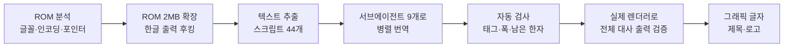

## 🔍 어떻게 동작하나요

원래 게임은 1바이트 가나와 2바이트 한자(앞자리 `F0~F3`)를 씁니다. 패치는 앞자리 `EC~F3` 8개를 한글 전용으로 바꾸고, 그 아래 2,048칸에 번역에 쓰인 음절을 담습니다.

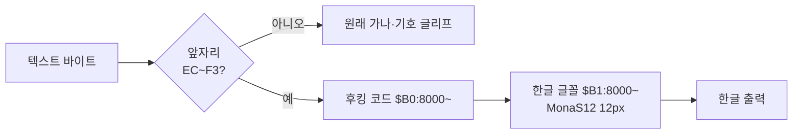

| 대상 | 변경 내용 |
|---|---|
| ROM 크기 | 1.5MB → 2MB (LoROM 확장, 뱅크 `$B0~$BF`) |
| 글자 해석 | 대사 `$81:85E6`, 창 텍스트 `$80:B9BD`의 앞자리 판정과 글리프 주소 계산 `$80:BADF`·`$80:BC75`를 후킹 |
| 한글 글꼴 | 번역에 쓰인 음절만 KS X 1001 순서로 배정, 도트 글꼴 MonaS12(12px) 변환, `$B1:8000~` |
| 텍스트 배치 | 번역문을 뱅크 `$B3~$BE`에 다시 배치하고 대사 블록 표 `$0C:8000`, 이름·창 표 목록 `$03:8090`을 고침 |
| 스테이지 제목 | 16×16 제목 글꼴(LZ 압축)을 MonaS12 획에 테두리·그러데이션을 입혀 다시 만들고 제목 묶음 64개를 새로 씀 |
| 타이틀 로고 | 로고 타일에 「슈퍼로봇대전」을 다시 그림(나눔스퀘어 ExtraBold), 파란 「EX」는 그대로 |

<details>
<summary><b>역공학 상세</b></summary>

- 제3차와 같은 엔진 계열이지만 코드 배치와 제어 코드 번호가 달라(뱅크별 바이트 일치 1~11%) 주소를 모두 새로 찾았습니다. 대사 제어 코드는 제3차보다 하나씩 밀려 있습니다(`F4` 줄바꿈 … `FF` 끝).
- 원래 앞자리 `EC~EF` 자리에 있던 아이콘 글자([M][HP][B][P])는 텍스트에서 쓰이지 않아 빈 1바이트 코드로 옮겼습니다.
- `.` `,`는 일본식 `。`(E4)·`、`(3A) 자리에 한국어 모양을 다시 그려 씁니다.
- 줄 폭 한도는 `$0E34`(4px 단위)입니다. 대화창은 60단위(240px), 전투창은 50단위(200px)·2줄이며, 빌드는 이 값으로 모든 대사의 폭을 검사합니다.
- 스테이지 제목은 그래픽 자료 4번(`$20:91A6`, LZ 압축 32KB)의 글꼴과 스프라이트 묶음 표(`$04:CEFE`)로 그립니다. 스테이지별 글꼴 블록은 블록 후보를 모두 그려 눈으로 대조해 정했습니다.
- 타이틀 로고는 그래픽 자료 47번(`$13:8000`)의 타일 0x201~0x275이며 타일맵은 그대로 두고 타일 그림만 바꿉니다.

</details>

## ✅ 검증

| 검사 | 방법 | 결과 |
|---|---|---|
| 전체 대사 출력 | Mesen2 Lua로 대사 조각을 차례로 실제 게임 렌더러에 흘려 출력 | 대사 33개 파일 끝까지 출력, 멈춤 0건 |
| 줄 넘침 | 같은 출력에서 줄 폭 한도 기록 | 1곳(얼굴 전환 연쇄 장면) — 원문 일본어도 같은 장치에서 같은 위치가 넘쳐 테스트 장치의 한계로 판단 |
| 실제 화면 | 새 게임 → 편 선택 → 프롤로그 → 1화 대화·제목·지도, 유닛 명령·능력 화면, 데모 전투 | 정상 |
| 패치 적용 | xdelta3 3.1.0·Flips로 원본 사본에 적용 | 빌드 ROM과 MD5 같음 |

> [!NOTE]
> 확인한 에뮬레이터는 Mesen2 2.1.1뿐입니다. 사람이 처음부터 끝까지 플레이해 확인하지 않았으며, 인터미션·엔딩·사운드 테스트는 실제 진행으로 확인하지 못했습니다. 일부 창에서 긴 이름이 테두리에 닿을 수 있습니다.

## 🤖 작업 방식: 사람이 지휘한 AI 하네스

이 패치는 **사람이 방향과 표기를 정하고, AI 하네스 [Claude Code](https://claude.com/claude-code)에서 Claude가 분석·구현·번역·검증을 맡아** 만들었습니다.

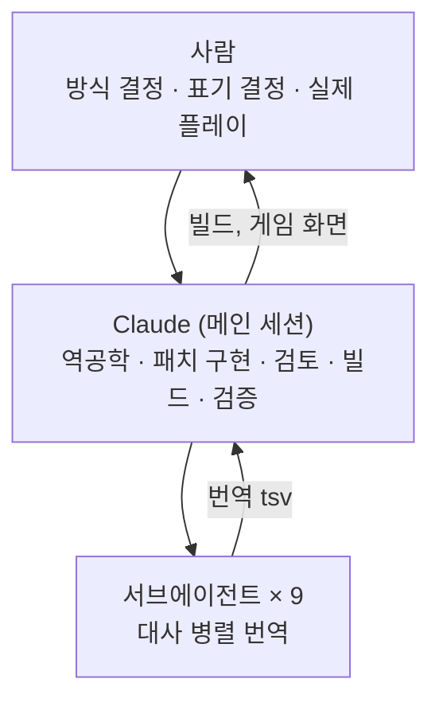

| 역할 | 담당 | 한 일 |
|---|---|---|
| 🧑 **작업 지휘** | 사람 | 제3차 패치의 방식·표기 기준 적용 결정, 실제 플레이와 피드백 |
| 🧠 **총괄** | Claude | 65816 역공학, 후킹·글꼴·그래픽 패치, 추출·삽입 도구, 이름·창 번역, 번역 검토, 자동 검증 |
| ✍️ **번역** | Claude 서브에이전트 | 번역 지침에 따라 대사를 파일별로 나눠 병렬 번역 |

AI가 낸 번역을 그대로 쓰지 않았습니다. 태그 순서, 줄 폭, 남은 가나·한자를 도구로 검사했고, 실제 게임 렌더러로 모든 대사를 출력해 확인했습니다.

## 🛠️ 직접 빌드

<details>
<summary><b>빌드 방법 펼치기</b></summary>

| 준비물 | 내용 |
|---|---|
| Python 3 | `Pillow` |
| 원본 ROM | 저장소 루트에 `Super Robot Taisen EX (J).smc` |
| 대사·메뉴·제목 글꼴 | [MonaS12](https://github.com/MonadABXY/mona-font) 릴리스 `2026.10.09`의 `MonaFont-ttf.zip`을 `tools/fonts/mona/`에 풀기(`MonaS/01 Main/MonaS12.ttf`). 다른 곳이면 환경 변수 `SRW3_MONAS12`로 파일 지정 |
| 로고 글꼴 | 나눔스퀘어 ExtraBold(`NanumSquareEB.ttf`). 기본은 Windows 사용자 글꼴 폴더에서 찾고, 다른 곳에 있으면 환경 변수 `SRW3_FONTDIR`로 폴더를 지정 |

```bash
cd build
python srwtext.py build
```

결과는 `out/srwex_ko.smc`와 `out/srwex_ko.ips`에 생깁니다. 배포용 xdelta는 다음으로 만듭니다.

```bash
xdelta3 -e -9 -s "Super Robot Taisen EX (J).smc" out/srwex_ko.smc srwex_ko.xdelta
```

- 번역은 `script/*.txt`의 `KO:` 줄을 고치거나, `tr/`의 tsv를 `python setko.py --file ../tr/x.tsv`로 반영합니다.
- 작업 인계 문서는 [HANDOFF.md](HANDOFF.md), 분석 문서는 `analysis/`에 있습니다.

</details>

## 📁 저장소 구성

```text
├── analysis/    ROM 분석 문서와 도구
├── build/       패치 빌드 (추출·삽입, 후킹·글꼴, 스테이지 제목, 타이틀 로고)
├── script/      번역 스크립트 44개 (대사 dlg*, 이름 sys*, 창 레이아웃 lay*) — 원문(JP:)과 번역(KO:) 대조
├── tr/          번역 보조 도구와 번역 원본 tsv
├── tools/rt/    Mesen2 자동 검증 Lua와 스크립트 생성기
├── dist/        배포 묶음의 README.txt와 OFL.txt
├── docs/images/ README 스크린샷
└── HANDOFF.md   작업 인계 문서
```

`script/`와 `tr/`에는 번역 대조와 검수를 위해 일본어 원문이 함께 들어 있습니다. 원본 ROM, 빌드 결과 ROM, 에뮬레이터는 저장소에 넣지 않습니다. 패치 파일은 Release 첨부로 배포합니다.

## 🔤 글꼴과 라이선스

| 쓰인 곳 | 글꼴 | 만든 곳 |
|---|---|---|
| 대사·메뉴·이름 (12px), 스테이지 도입 제목 | [MonaS12](https://github.com/MonadABXY/mona-font) | Monad ABXY |
| 타이틀 로고 | 나눔스퀘어 ExtraBold | NAVER |

모두 SIL Open Font License 1.1로 배포되는 글꼴을 흑백 비트맵으로 변환해 넣었습니다. 저작권 표시와 라이선스 전문은 릴리스의 `OFL.txt`에 있습니다.

## ⚖️ 권리와 안내

- **제작 목적:** 슈퍼로봇대전 EX를 좋아하는 한국 팬들을 위해 순수한 팬의 입장에서 만들었습니다. 상업적 목적이 없으며 무료로 제공합니다.
- **권리:** 원작과 등장 작품·캐릭터의 모든 권리는 각 권리자에게 있습니다. 이 패치는 비공식이며 권리자의 승인을 받지 않았습니다. 제작자는 이 패치에 대해 어떠한 배타적 권리도 주장하지 않습니다.
- **ROM 미포함:** 패치 파일만 배포하며 ROM은 배포하지 않습니다. 패치하려면 직접 가지고 있는 원본 ROM이 필요합니다.
- **제공 중단:** 권리자가 요구할 경우 패치 제공을 중단할 수 있습니다.
- **대응 속도:** 제작자는 직장을 다니는 평범한 직장인입니다. 문제 제보에 대한 대응이 늦을 수 있으니 양해 부탁드립니다.

## 📢 AI 사용 고지

이 프로젝트는 Anthropic의 AI 모델인 Claude와 함께 작업했으며, 책임은 작성자에게 있습니다.
